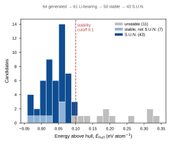

# Project 3 — Generative Inverse Design: generate → screen → score

**What this is.** A concept-validation bonus that demonstrates the inverse-design paradigm and
wires up a full `generate → screen → validate` loop. **Synthesizability is explicitly not
claimed** — the point is the method and the closed loop, not the individual candidates.

Position in the portfolio: the main line is Project 1 (Materials Project screen, 21,712 → 248 →
62 compositions) → Project 2 (MLIP-MD census and independent replicates; four leads hold up) →
Project 4 (Li-metal interface gate). **Project 3 is a parallel side-track** that generates
candidates outside the known Materials Project space. It does not consume Project 1's screening
output; it only reuses Project 1's trained CatBoost model internally as an off-the-shelf scorer
(see MVP step 3 below). Its 43 S.U.N. structures have not yet been run through Project 2's
census protocol; two of them were part of the July 2026 four-lead pilot.

## Headline
- **A full generate → screen → score loop runs end-to-end.** MatterGen (conditioned on Li-P-S)
  → self-consistent MLIP convex hull + S.U.N. novelty → Project-1 CatBoost conductivity prior:
  **64 generated → 61 Li-bearing → 50 stable → 43 S.U.N.**
- **The conductivity prior is weak and descriptive; it does not pick a shortlist.** Rescored on
  2026-10-19 with Project 1's current 15-member CatBoost ensemble (134 formula-only Magpie
  features, trained on all 599 OBELiX records), the prior largely rewards Li content (Spearman
  ρ = 0.93 against Li atomic fraction over the 26 distinct scored compositions). Its head is
  Li-rich and S-poor — Li₈PS₂ (−2.78), Li₆PS (−3.78), Li₇PS₂ (−3.83 log₁₀ S/cm) — and of the top
  eight S.U.N. formulas only Li₇PS₂ charge-balances with Li⁺, S²⁻ and P³⁻ or P⁵⁺. The score
  therefore describes candidates but selects none: **all 43 S.U.N. structures go to the Project 2
  census as the next batch (not yet run).**
- **July 2026 pilot (historical, single seed): two structures went to Project 2 MD** — Li₃PS₄
  (gen_016, e_above_hull 0.006, a novel β-polymorph essentially on the hull) and LiPS₃ (gen_021,
  e_above_hull −0.031, an MLIP-predicted new ground state). On Project 1's current ensemble,
  LiPS₃ is still last of the four pilot leads (two from each independent track: Li₂₀Si₃P₃S₂₃Cl
  −2.26, Li₃PS₄ gen_016 −6.05, Li₈TiS₆ −6.63, LiPS₃ gen_021 −9.81), although its single-seed MD σ
  (~10 mS/cm) was the second highest; gen_016 is now second on the prior although its pilot MD σ
  was very low (5.5×10⁻³ mS/cm). The prior spans 7.6 log units across the four, wider than the
  ~4.5 orders of magnitude of the pilot MD, and the two orderings agree only partly. A single-seed
  pilot validates or falsifies nothing; it is kept as history.

## Where this fits in the portfolio


*Full pipeline diagram lives in the Project 2 repo: [Solid-Electrolyte-MLIP-MD/figures/supplementary/08_pipeline_overview.png](https://github.com/E1582271-dotcom/Solid-Electrolyte-MLIP-MD/blob/main/figures/supplementary/08_pipeline_overview.png) (generated by [`08_pipeline_overview.py`](https://github.com/E1582271-dotcom/Solid-Electrolyte-MLIP-MD/blob/main/08_pipeline_overview.py)). This repo is **Project 3 (generate)** in that diagram, drawn as its own parallel track into
Project 2, not downstream of Project 1 — two of its S.U.N. structures (Li₃PS₄ gen016, LiPS₃ gen021)
were run with single-seed MLIP-MD in the July 2026 pilot in [Solid-Electrolyte-MLIP-MD](https://github.com/E1582271-dotcom/Solid-Electrolyte-MLIP-MD) (historical; the 43 S.U.N. structures have not yet been through the Project 2 census). Downstream, the fourth gate (`Solid-Electrolyte-Interface-MD`, Project 4) ran explicit Li-metal interface-reaction MD on the pilot's bulk survivors: LiPS₃ gen021 — high single-seed bulk σ in the pilot — is consumed at the Li interface within its slab, an honest interface-gate FAIL that bulk σ alone could not have caught.*

## MVP

1. **Generate** — sample candidate structures from a pretrained **MatterGen** diffusion model,
   **conditioned on the chemical system Li-P-S**.

   

   *Raw MatterGen output is already skewed toward low `e_above_hull` under this conditioning —
   most of the funnel's attrition (64 → 43 S.U.N.) happens gently, not from a pile of wildly
   unstable structures (see the grey `unstable` tail above the 0.1 eV/atom cutoff).*

2. **Stability screen** — relax each candidate with a universal MLIP (**MACE-MP-0**), compute
   `e_above_hull` (energy above the convex hull), and report **S.U.N.** (Stable + Unique + Novel)
   — the same lens MatterGen reports for itself.
3. **Score** — apply **Project 1's OBELiX-trained CatBoost conductivity ensemble** (formula-only)
   to give survivors a coarse, descriptive prior.
4. **Output** — the S.U.N. set of "new and relatively stable" candidates (43 structures). All of
   them are the next batch for Project 2's census protocol; the prior annotates them but is not
   used to cut the list.

   

   *Panel a is the screen+score result — stability (`e_above_hull`) vs Project 1's current
   formula-only conductivity prior for every scored candidate, S.U.N. status colour-coded; panel b
   shows the eight S.U.N. structures with the highest prior (bars = ensemble mean, whiskers =
   ensemble SD). Panel b describes where the prior points — Li-rich, S-poor formulas — and is not
   a shortlist: all 43 S.U.N. structures go to Project 2. Full table and discussion in [Results](#results-nus-vanda-a40-2026-07-01-rescored-2026-10-19) below.*

## Numbered pipeline scripts + reusable `src/` (same convention as Projects 1 & 2)

| script | role | runs on |
|---|---|---|
| `src/generate.py` + `01_generate.py` | `--source mattergen` runs the official conditional-generation CLI; `--source from-results` reads an existing `*_cif.zip`; `--source mp-demo` pulls real Li-P-S phases as an **offline plumbing fixture** (not generative output; `--rattle` displaces atoms to mimic unrelaxed cells) | mattergen=GPU; else CPU |
| `src/stability.py` + `02_screen_stability.py` | reference phases **and** candidates relaxed with the **same** MLIP → **self-consistent convex hull** → `e_above_hull`; `--calc mace\|chgnet` (real) / `lj` (CPU plumbing fixture, energies meaningless) | GPU (except lj) |
| `src/novelty.py` | StructureMatcher de-dup among candidates (Unique) + comparison against known MP phases (Novel) | CPU |
| `src/score.py` + `03_score_conductivity.py` | applies the vendored Project-1 production ensemble (`vendor/p1_conductivity.py` + 15 `vendor/p1_models/*.cbm`, checksums in `vendor/p1_manifest.json`) to each candidate's formula → log₁₀σ prior = ensemble mean, with ensemble SD and applicability-domain distance | CPU |
| `04_rank_candidates.py` | merge screen + score → `candidates_final.csv` + `p3_runs.json` + two quick-look figures | CPU |
| `figures/make_publication_figure.py` | builds a **publication-grade composite figure** from `candidates_final.csv` (landscape + top-8 S.U.N. by prior, two panels, vector SVG) | CPU |
| `notebooks/01_mattergen_pipeline.ipynb` | cloud orchestration: stage A (isolated py3.10 venv runs MatterGen) → stage B (MACE screen + score) | Colab T4 / Vanda |

```bash
# 0) install deps (Python 3.10-3.12; MatterGen generation is a SEPARATE py3.10 env, installed
#    separately -- see HPC_VANDA.md)
pip install -r requirements.txt

# local (CPU plumbing check, no GPU) -- proves the generate->screen->score->rank wiring works
python 01_generate.py --source mp-demo --max-demo 6 --rattle 0.1
python 02_screen_stability.py --calc lj --steps 3 --no-relax-cell
python 03_score_conductivity.py
python 04_rank_candidates.py --top 8

# cloud (GPU production) -- see notebooks/01_mattergen_pipeline.ipynb
python 01_generate.py --source mattergen --chemsys Li-P-S --batch-size 16 --num-batches 4
python 02_screen_stability.py --calc mace --ehull-cutoff 0.1
python 03_score_conductivity.py --stable-only && python 04_rank_candidates.py --top 8
```

> **Self-contained scoring.** Project 1's production conductivity ranker — a 15-member CatBoost
> ensemble on 134 formula-only Magpie descriptors, trained on all 599 OBELiX records — is
> **vendored** under `vendor/` (15 `.cbm` members + `p1_conductivity.py`, sha256 of every member
> in `vendor/p1_manifest.json`, matching Project 1's release manifest), so this repo clones and
> runs on its own — **no need to clone Project 1 alongside**, and `score.py` always uses the
> vendored copy. To pick up a new
> [Project 1](https://github.com/E1582271-dotcom/Solid-Electrolyte-Screening) release, run
> `python vendor/refresh_from_p1.py --p1 <path-to-project1>` (see `vendor/README.md`).

## Design decisions

- **Two-stage isolation.** MatterGen pins Python 3.10 with its own torch/lightning stack, which
  clashes with the MACE screening environment. Generation runs as a CLI subprocess in a dedicated
  venv; screening/scoring run in the kernel; the `--source from-results` seam joins them, so the
  screening environment **does not depend on the mattergen package**.
- **Self-consistent MLIP hull** (not mixed MP/PBE energies). Reference phases and candidates are
  relaxed with the same universal MLIP before building the hull, avoiding the systematic
  `e_above_hull` bias you get from mixing "MLIP candidate energy vs PBE+U reference energy"
  (inconsistent reference states) — this matches MatterGen's own evaluator. Reference energies are
  cached by `material_id`, so re-runs are fast.
- **CPU plumbing fixtures** (`mp-demo` + `lj`). Following Project 2's
  Lennard-Jones idea, the whole downstream pipeline can be developed and verified on a GPU-less
  laptop; those outputs are clearly labelled "plumbing check, non-physical".
- **Require the mobile ion Li** (`01_generate.py --require-elements Li`, on by default). Conditioned
  on `chemical_system=Li-P-S`, MatterGen also emits **Li-free P–S binaries**, which the Project-1
  model happily scores — so a Li-ion-conductor screen must first require Li, or the top of the
  ranking fills with meaningless Li-free phases (this run dropped 3 Li-free phases, keeping 61).
- **Portable reference cache** (`data/ref_structures.json`, not a pickle). Reference phases are
  cached as pymatgen `Structure` (`as_dict`), readable across pymatgen versions; a directly pickled
  MP entry fails to unpickle when the two ends run different pymatgen versions, so we use structure
  JSON.

## Known limitations (disclosed)

- **Most generated structures are unstable / unsynthesizable** → they must pass the MLIP stability
  screen (this project's core signal).
- `e_above_hull` comes from an **un-fine-tuned** universal MLIP: a relative-stability indicator, not
  DFT-quantitative. The self-consistent hull removes the reference-state mismatch, but the MLIP's own
  bias remains.
- The conductivity score is a **weak, descriptive prior** (Project-1 ensemble): it is formula-only,
  so every polymorph of a composition receives the same score (ties are broken by `e_above_hull`);
  on this run it largely tracks Li fraction and favours Li-rich formulas that mostly do not
  charge-balance, and for compositions already in OBELiX (Li₃PS₄, Li₂PS₃, LiPS₃) it largely echoes
  their measured values. It describes candidates but is not used to select them for Project 2 —
  **not a quantitative σ**.
- MatterGen's own paper validated a single synthesis → this is positioned as **concept validation**,
  with no over-promise.

## Status

- ✅ **Local CPU end-to-end plumbing verified** (`mp-demo`, 6 real Li-P-S phases + `lj` hull):
  generate → screen (`e_above_hull` + de-dup + novelty, 96 MP reference phases incl. Li/P/S
  endpoints) → score (Project-1 CatBoost scorer; at the time a bridge into a sibling Project 1
  checkout with the cross-project `src` package-name clash isolated — since 2026-10-19 the
  ensemble is vendored under `vendor/` and loaded under its own module name, so no clash arises)
  → rank + 2 figures, all wired.
  *Note: `lj` energies are non-physical and `mp-demo` fixtures are not generative output, so
  `novel=False` for all of them (they are known phases) — which correctly confirms the novelty test.*
- ✅ **Cloud production run (NUS Vanda A40, 2026-07-01)**: MatterGen conditional generation of
  Li-P-S (batch 16×4=64) → Li filter (dropped 3 Li-free P–S binaries, keeping 61) → MACE-MP-0
  self-consistent hull screen (96 reference phases) → Project-1 CatBoost scoring → ranked figures.
  See `HPC_VANDA.md` (PBS + Singularity, reusing Project 2's `~/macepkg`, entirely free).
- ✅ **Rescore (2026-10-19)**: the 50 stable candidates rescored with Project 1's current
  vendored 15-member ensemble; `data/candidates_final.csv`, `data/p3_runs.json`, the figures and
  `source_data/` were regenerated. The retired July 2026 single-model scores are superseded.
- ✅ **W11**: two structures (Li₃PS₄ gen016, LiPS₃ gen021) run with single-seed Project 2 MLIP-MD
  in the July 2026 pilot (LiPS₃ ~10 mS/cm, Li₃PS₄ 5.5×10⁻³ mS/cm) — single-seed pilot labels that
  neither validate nor falsify either structure (see "Historical four-lead pilot (July 2026)" in
  [Solid-Electrolyte-MLIP-MD/README_Li6PS5Cl_case_study.md](https://github.com/E1582271-dotcom/Solid-Electrolyte-MLIP-MD/blob/main/README_Li6PS5Cl_case_study.md));
  unified pipeline diagram drawn (`Solid-Electrolyte-MLIP-MD/figures/supplementary/08_pipeline_overview.png`, linked at
  the top of this README).

## Results (NUS Vanda A40, 2026-07-01; rescored 2026-10-19)

**64 generated → 61 Li-bearing → 50 stable → 43 S.U.N.** (`ehull_cutoff=0.1 eV/atom`). Uniqueness
and novelty are independent flags over the 61-candidate pool (54/61 unique; **61/61 novel** — every
survivor is a new polymorph vs the known MP phases), so the 43 S.U.N. is the stable ∧ unique ∧ novel
intersection; full table in `data/candidates_final.csv`, counts in `data/p3_runs.json`. Figures for
both the generation funnel and this stability-conductivity landscape are shown inline above, in
[MVP](#mvp) steps 1 and 4 respectively.

**Conductivity prior (Project 1's current 15-member ensemble, vendored; rescored 2026-10-19).** The
50 stable candidates cover 26 distinct compositions and span 7.0 log units (−2.78 to −9.81 log₁₀
S/cm). These scores replace those of the retired July 2026 single-CatBoost model; the two rankings
are essentially unrelated (Spearman ρ = −0.19 over the 50 scored candidates), so score-based
statements made on the old scale are withdrawn. The new prior largely rewards Li fraction (Spearman
ρ = 0.93 against Li atomic fraction over the 26 compositions; `Li_frac` is itself one of the 134
features), and none of the 50 is flagged extrapolative at Project 1's frozen q75 route thresholds
(ensemble spread 0.385, AD distance 12.15).

Top S.U.N. structures by the prior — **descriptive only, not a shortlist**; all 43 S.U.N.
structures go to the Project 2 census as the next batch (not yet run):

| S.U.N. rank | candidate | e_above_hull (eV/atom) | predicted log₁₀σ ± ensemble SD (S/cm) | AD distance | note |
|---|---|---|---|---|---|
| 1 | Li8PS2 (gen_040) |  0.019 | −2.78 ± 0.33 | 5.41 | Li excess: decomposes on the MLIP hull to Li₃P + Li₂S + Li metal; not charge-balanced |
| 2 | Li6PS (gen_027)  |  0.035 | −3.78 ± 0.26 | 5.48 | Li excess: decomposes to Li₃P + Li₂S + Li metal; not charge-balanced |
| 3 | Li7PS2 (gen_038) |  0.049 | −3.83 ± 0.28 | 5.29 | Li₃P + 2 Li₂S stoichiometry; balances only with P³⁻ (a phosphide-sulfide, not a thiophosphate) |
| 4 | Li4PS5 (gen_006) |  0.080 | −4.28 ± 0.18 | 0.85 | decomposes to Li₂S + Li₃PS₄ + S |
| 5 | Li9P2S9 (gen_035) | 0.046 | −4.79 ± 0.20 | 4.74 | decomposes to Li₂S + Li₃PS₄ + P |
| 6 | Li9P2S5 (gen_056) | 0.097 | −5.01 ± 0.28 | 4.89 | decomposes to Li₂S + Li₃PS₄ + P |
| 7 | Li5PS4 (gen_049) |  0.087 | −5.14 ± 0.29 | 4.78 | decomposes to Li₂S + Li₃PS₄ + P |
| 8 | Li7PS7 (gen_043) |  0.074 | −5.47 ± 0.38 | 4.74 | decomposes to Li₂S + Li₃PS₄ + S |
| … | | | | | |
| 13 | **Li3PS4 (gen_016)** | 0.006 | −6.05 ± 0.15 | 0.45 | the hero: β-Li₃PS₄ is a known fast-ion conductor and this is a generated **novel polymorph**, essentially on the hull; Li₃PS₄ is in OBELiX, so its score largely echoes measured values; the three S.U.N. Li₃PS₄ polymorphs tie at #12–14 |
| 37 | LiPS3 (gen_021)  | −0.031 | −9.81 ± 0.21 | 3.03 | `e_above_hull < 0` → an MLIP-predicted **new ground state**; LiPS₃ is in OBELiX; its seven S.U.N. polymorphs tie at #37–43 (last) |

Of the top eight, only Li₇PS₂ charge-balances with Li⁺, S²⁻ and P³⁻ or P⁵⁺. The four July 2026
pilot leads on the same ensemble — Li₂₀Si₃P₃S₂₃Cl −2.26 and Li₈TiS₆ −6.63 (Project 1's own
scores), Li₃PS₄ gen_016 −6.05 and LiPS₃ gen_021 −9.81 — span 7.6 log units, against ~4.5 orders of
magnitude in the single-seed pilot MD (29 to 9×10⁻⁴ mS/cm). Both put Li₂₀Si₃P₃S₂₃Cl first and
gen_016 above Li₈TiS₆, but the prior puts LiPS₃ last where the pilot MD put it second. The pilot is
historical and single-seed, so this comparison validates or falsifies neither the prior nor any
of the four materials.

> Honest disclosure: `e_above_hull` comes from an **un-fine-tuned** MACE-MP-0 (relative stability,
> not DFT-quantitative); log₁₀σ is Project 1's formula-only ensemble prior — **a weak descriptive
> prior, not a quantitative σ and not a selector**. It never sees the generated structure, so all
> polymorphs of a composition tie; it largely tracks Li fraction; and for compositions already in
> OBELiX (Li₃PS₄, Li₂PS₃, LiPS₃; 18 of the 50 scored structures) it largely echoes measured values.
> All 43 S.U.N. structures are the next batch for Project 2's census + replicate protocol (not yet
> run) — positioned as **concept validation**, with no synthesizability claim.
