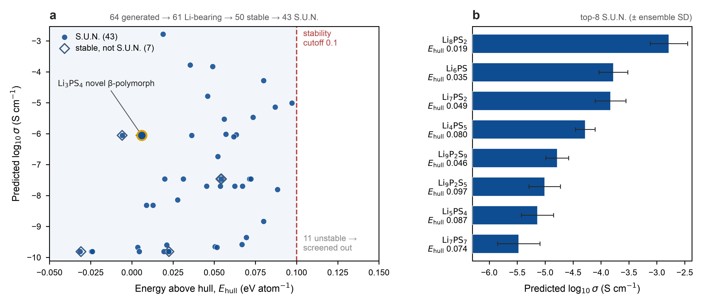

# Solid-Electrolyte-Inverse-Design

**Can a generative model propose Li–P–S structures outside the known Materials Project space that are stable, unique and novel under a universal machine-learning potential?**

A side-track of the solid-electrolyte work. Instead of screening known Materials Project entries, this repository samples Li–P–S crystal structures from MatterGen, a pretrained diffusion model conditioned on the chemical system, and screens them on a convex hull built with MACE-MP-0. The 43 stable, unique and novel (S.U.N.) structures it finds are the next input batch for the Solid-Electrolyte-MLIP-MD census; they have not been simulated yet. The 15-member CatBoost conductivity ensemble of Project 1 (Solid-Electrolyte-Screening) is reused only as a descriptive prior and selects nothing. This is concept validation; synthesizability is not claimed.



## Result

- **64 generated → 61 Li-bearing → 50 stable → 43 S.U.N.** (e<sub>above hull</sub> ≤ 0.1 eV/atom on a self-consistent MACE-MP-0 hull of 96 Materials Project reference phases). 54 of the 61 Li-bearing candidates are unique and all 61 are novel polymorphs relative to the known MP phases.
- **The conductivity prior is weak and descriptive.** Rescored on 2026-10-19 with Project 1's 15-member CatBoost ensemble (134 formula-only Magpie features, trained on all 599 OBELiX records), the 50 stable candidates span 7.0 log units (−2.78 to −9.81 log<sub>10</sub> S/cm). The prior largely rewards Li content (Spearman ρ = 0.93 against Li atomic fraction over the 26 distinct compositions).
- **Its head is Li-rich and S-poor**: Li<sub>8</sub>PS<sub>2</sub> (−2.78), Li<sub>6</sub>PS (−3.78), Li<sub>7</sub>PS<sub>2</sub> (−3.83). Of the top eight S.U.N. formulas only Li<sub>7</sub>PS<sub>2</sub> charge-balances with Li<sup>+</sup>, S<sup>2−</sup> and P<sup>3−</sup> or P<sup>5+</sup>. The score therefore describes the candidates but selects none: **all 43 S.U.N. structures go to the Solid-Electrolyte-MLIP-MD census as the next batch (not yet run).**
- A novel β-Li<sub>3</sub>PS<sub>4</sub> polymorph (gen_016, e<sub>above hull</sub> 0.006 eV/atom) and an MLIP-predicted new LiPS<sub>3</sub> ground state (gen_021, −0.031 eV/atom) are among the S.U.N. set. Both were run once, single-seed, in a July 2026 pilot; that pilot validates or falsifies nothing and is kept as history.

Every count, the top-ranked table and the pilot comparison: [docs/results.md](docs/results.md).

## Approach

1. **Generate.** MatterGen, conditioned on the chemical system Li-P-S, samples 64 structures in an isolated Python 3.10 environment. Li-free P–S binaries (3) are dropped.
2. **Stability screen.** Candidates and the 96 reference phases are relaxed with the same un-fine-tuned MACE-MP-0, so `e_above_hull` is computed on a self-consistent MLIP hull rather than against PBE+U reference energies. Each candidate is flagged stable, unique (StructureMatcher among candidates) and novel (not matched to a known MP phase).
3. **Score.** Project 1's production ensemble, vendored with checksums under [vendor/](vendor/README.md), gives each stable candidate a formula-only log<sub>10</sub>σ prior with ensemble spread and applicability-domain distance. It annotates the candidates; it is not used to cut the list.
4. **Output.** The 43 S.U.N. structures, with their stability and prior, in [data/candidates_final.csv](data/candidates_final.csv).


Scripts, design decisions and the scorer: [docs/methods.md](docs/methods.md).

## Limits

- `e_above_hull` comes from an un-fine-tuned universal potential: a relative-stability indicator, not DFT-quantitative. The self-consistent hull removes the reference-state mismatch but not the potential's own bias.
- The conductivity prior is formula-only and never sees the generated structure, so all polymorphs of a composition tie. It largely tracks Li fraction, favours Li-rich formulas that mostly do not charge-balance, and for compositions already in OBELiX (Li<sub>3</sub>PS<sub>4</sub>, Li<sub>2</sub>PS<sub>3</sub>, LiPS<sub>3</sub>; 18 of the 50 scored structures) it largely echoes measured values. It is not a quantitative σ.
- No generated structure has a simulated conductivity yet.
- Most generated structures are unstable or unsynthesizable, and MatterGen's own paper validated a single synthesis. This is concept validation; synthesizability is not claimed.

## Reproduce

```bash
pip install -r requirements.txt          # screening, scoring and figures (Python 3.10-3.12)
python -m pytest -q tests                # vendored-ensemble checksums and parity, pipeline fixes

# CPU plumbing check (no GPU; energies are non-physical)
python 01_generate.py --source mp-demo --max-demo 6 --rattle 0.1
python 02_screen_stability.py --calc lj --steps 3 --no-relax-cell
python 03_score_conductivity.py
python 04_rank_candidates.py --top 8

# GPU production
python 01_generate.py --source mattergen --chemsys Li-P-S --batch-size 16 --num-batches 4
python 02_screen_stability.py --calc mace --ehull-cutoff 0.1
python 03_score_conductivity.py --stable-only && python 04_rank_candidates.py --top 8
python figures/make_publication_figure.py && python figures/make_generation_funnel_figure.py
```

MatterGen generation needs its own Python 3.10 environment, installed separately. The production run used PBS and Singularity on NUS Vanda ([docs/hpc_vanda.md](docs/hpc_vanda.md)); [notebooks/01_mattergen_pipeline.ipynb](notebooks/01_mattergen_pipeline.ipynb) runs both stages on Colab.

## Repository

| Path | Content |
|---|---|
| [docs/results.md](docs/results.md) | funnel counts, the conductivity prior, top-ranked S.U.N. table, July 2026 pilot, status |
| [docs/methods.md](docs/methods.md) | pipeline, scripts, conductivity prior, design decisions, limitations |
| [docs/figures.md](docs/figures.md) | both figures with captions |
| [docs/hpc_vanda.md](docs/hpc_vanda.md) | environment setup and job submission on NUS Vanda (A40) |
| `01_generate.py` … `04_rank_candidates.py`, [src/](src/) | pipeline scripts and the generation, stability, novelty and scoring code |
| [vendor/](vendor/README.md) | Project 1's 15-member CatBoost ensemble with checksums, scorer and refresh tool |
| [data/](data/), [docs/data.md](docs/data.md) | candidate table, run record (`p3_runs.json`), cached reference structures; what is and is not included |
| [figures/](figures/), [source_data/](source_data/) | figures (PNG, SVG), their makers, and the plotted values |
| `run_p3.pbs`, `*_in_container.sh`, `setup_*.sh` | cluster job and environment scripts |
| [tests/](tests/) | vendored-ensemble parity and checksum tests, pipeline regression tests |

## Related projects

Part of a computational portfolio on sulfide solid electrolytes:

- [Solid-Electrolyte-Screening](https://github.com/E1582271-dotcom/Solid-Electrolyte-Screening) screens all 21,712 Li-containing Materials Project entries down to 62 candidate Li–S compositions.
- [Solid-Electrolyte-MLIP-MD](https://github.com/E1582271-dotcom/Solid-Electrolyte-MLIP-MD) classifies those 62 compositions with MACE-MP-0 molecular dynamics under a pre-registered protocol (11 fast conductors).
- [MLIP-fine-tune](https://github.com/E1582271-dotcom/MLIP-fine-tune) compares universal and DFT-fine-tuned potentials with DFT and AIMD for Li transport in Li<sub>6</sub>PS<sub>5</sub>Cl.
- [MACE-Envtok](https://github.com/E1582271-dotcom/MACE-Envtok) is a from-scratch implementation of MACE, trained with multi-node DDP on the EnvTok subset of OMat24.

## Citation and license

Cite with [CITATION.cff](CITATION.cff). Code and data are under the MIT license ([LICENSE](LICENSE)). Author: Jieao Jia. `vendor/p1_obelix_formulas.csv` is derived from OBELiX and redistributed under CC BY 4.0 ([vendor/README.md](vendor/README.md)); reference structures come from the Materials Project and are subject to its [terms](https://materialsproject.org/about/terms); MatterGen and MACE-MP-0 weights are downloaded from their sources under their own licenses.
