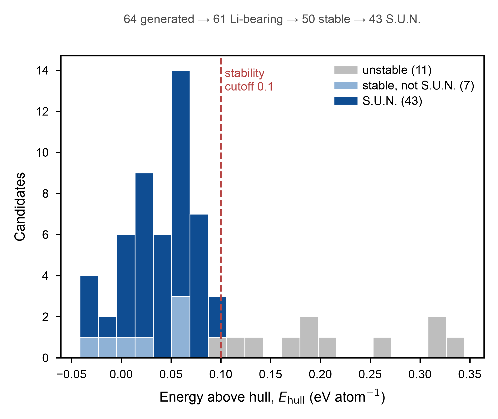
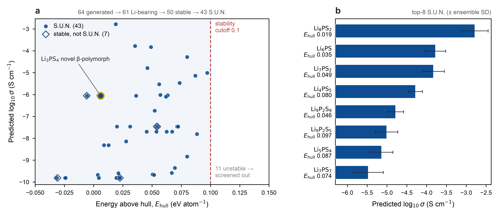

# Figures

Both figures are tracked as PNG (600 dpi) and SVG (editable text, `svg.fonttype='none'`) in
[figures/](../figures/); the plotted values are in [source_data/](../source_data/). Styling is set
in [src/plotstyle.py](../src/plotstyle.py): a CORE block (palette, sizing,
`apply_publication_style()`, `finalize_figure()`, `save_source_data()`) shared with the sibling
repositories, plus this project's S.U.N.-status palette (`C_SUN`/`C_STABLE`/`C_UNSTABLE`/`C_CUT`).
Rebuild with `python figures/make_generation_funnel_figure.py` and
`python figures/make_publication_figure.py`.

Fig. 1 shows what raw MatterGen output looks like before any filtering (generate). Fig. 2 shows
where the survivors land after the self-consistent MLIP hull and the conductivity prior, and where
the descriptive, non-selecting prior points (screen + score + output).

## Fig. 1. Generation-step funnel

`figures/fig_generation_funnel.*`. Distribution of `e_above_hull` for all 61 Li-bearing MatterGen
candidates (of 64 raw generations; 3 Li-free P–S binaries dropped before this point), stacked by
final status: unstable (screened out) / stable-not-S.U.N. / S.U.N., with the 0.1 eV/atom stability
cutoff marked (same value as Fig. 2). Funnel counts annotated: 64 generated → 61 Li-bearing → 50
stable → 43 S.U.N. (counts and cutoff read from `data/p3_runs.json`, cross-checked against
`candidates_final.csv`). Raw MatterGen output under this conditioning is already skewed toward low
`e_above_hull`; most of the attrition (64 → 43 S.U.N.) is gradual, not a pile of wildly unstable
structures (grey `unstable` tail above the cutoff).
*Stats:* n = 61 screened candidates (deterministic MLIP relaxation, no repeats).
*Source:* `source_data/fig_generation_funnel.csv`.

## Fig. 2. Stability–conductivity-prior landscape and the top-scored S.U.N. structures

`figures/fig_inverse_design.*`. (**a**) `e_above_hull` vs the Project 1 CatBoost conductivity prior
(`log₁₀σ`, mean of the current 15-member ensemble, rescored 2026-10-19) for all 50 scored (stable)
candidates: 43 S.U.N. (filled circles) and 7 stable but not S.U.N. (open diamonds); stability cutoff
(0.1 eV/atom) marked. The 11 screened-out unstable candidates are not scored and sit off-panel
(`e_above_hull` up to ~0.34), counted in an annotation. The novel β-Li₃PS₄ polymorph gen_016
(e_above_hull ≈ 0.006, prior −6.05) is ringed. (**b**) The eight S.U.N. structures with the highest
prior (Li₈PS₂, Li₆PS, Li₇PS₂, Li₄PS₅, Li₉P₂S₉, Li₉P₂S₅, Li₅PS₄, Li₇PS₇; −2.78 to −5.47), each
labelled with its `e_above_hull` (bars = ensemble mean, whiskers = ensemble SD; the scorer is
formula-only, so polymorphs tie and ties are broken by `e_above_hull`). Panel b is **descriptive,
not a shortlist**: the prior's head is Li-rich and S-poor and mostly not charge-balanced, so it is
not used to select; all 43 S.U.N. structures are the next batch for the Solid-Electrolyte-MLIP-MD
census (not yet run). gen_016 is S.U.N. #13 and is not in panel b.
*Stats:* `e_above_hull` from a **self-consistent** MLIP hull (candidates and the 96 MP reference
phases relaxed with the same un-fine-tuned MACE-MP-0), a relative-stability indicator, not
DFT-quantitative; `log₁₀σ` is a weak descriptive prior (Project 1 model), not a quantitative σ (see
[methods.md § Limitations](methods.md#limitations)).
*Source:* `source_data/fig_inverse_design.csv` (all scored candidates with ensemble mean and SD; the
`shortlist_rank` column marks the eight S.U.N. structures plotted in panel b; the column name is
kept for compatibility and does not mean they were selected).

## Diagnostic figures (not tracked)

`04_rank_candidates.py` also writes `figures/01_landscape.png` and `figures/02_shortlist.png` on
every run. They are quick-look versions of Fig. 2 and are ignored by git.
